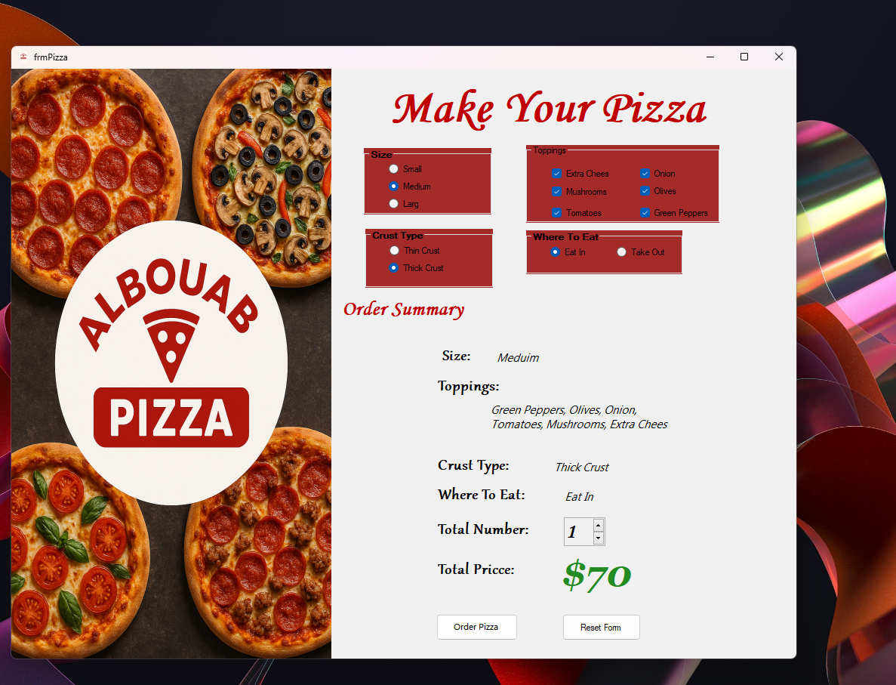
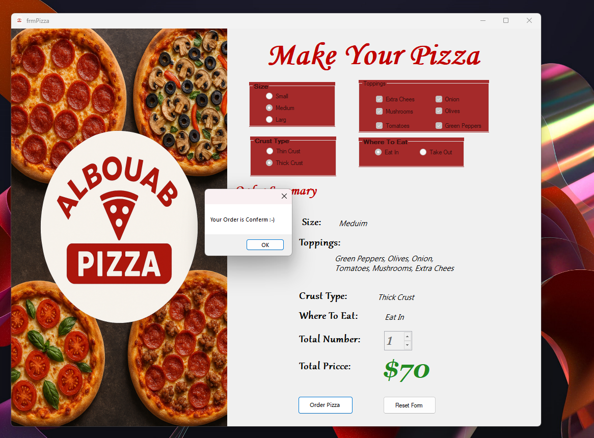

# PIZZA Ordering System

## 📌 Project Overview

PIZZA Ordering System is a Windows Forms desktop application for managing pizza orders.

The system provides a user-friendly interface for customers to browse menu items, select pizza orders, and track order status from selection to confirmation.

This project was built as part of practical training while studying desktop application development.

---

## 🏗 System Architecture

This is a **Single Tier Architecture** application:
1. **Presentation Layer**
   * Windows Forms UI
   * Menu display
   * Order management interface
2. **Application Logic**
   * Order processing
   * Menu management
   * Pricing calculations
   * Cart management
3. **Data Storage**
   * None (client-side application)
   * In-memory cart data

---

## 🛠 Technologies Used

* C#
* .NET Framework – Windows Forms
* SQL Server
* ADO.NET
* Visual Studio

---

## ✨ System Features

### 🍕 Menu Management

* Display available pizza options
* Show pizza details (size, toppings, price)
* Categorized menu items

---

## ⚙️ Installation & Setup

1️⃣ Clone the repository

```bash
[git clone https://github.com/mohamed-shaaban-cs/PIZZA.git] 
```

2️⃣ Open the solution file in Visual Studio.

5️⃣ Run the project.

---

## 📷 Screenshots

### 🍕 Select Order



### ✅ Order Confirmation



---

## 🚀 Future Enhancements

* User authentication and registration
* Order history tracking
* Customer profiles
* Delivery tracking
* Payment integration
* Discount system
* Review and ratings
* Multiple locations support

---

## 👨‍💻 Author

**Mohamed Shaaban**

* GitHub: [https://github.com/ss24214859](https://github.com/ss24214859)

---

## 📜 License

This project is for learning purposes and training.
